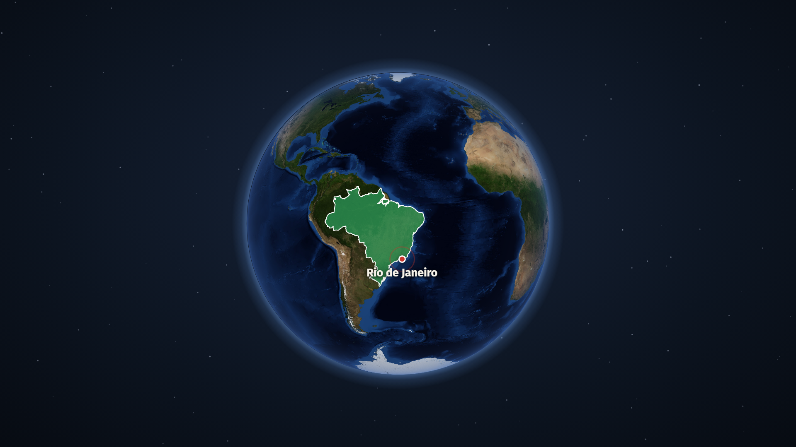
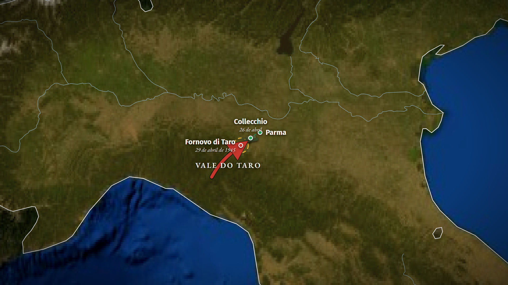
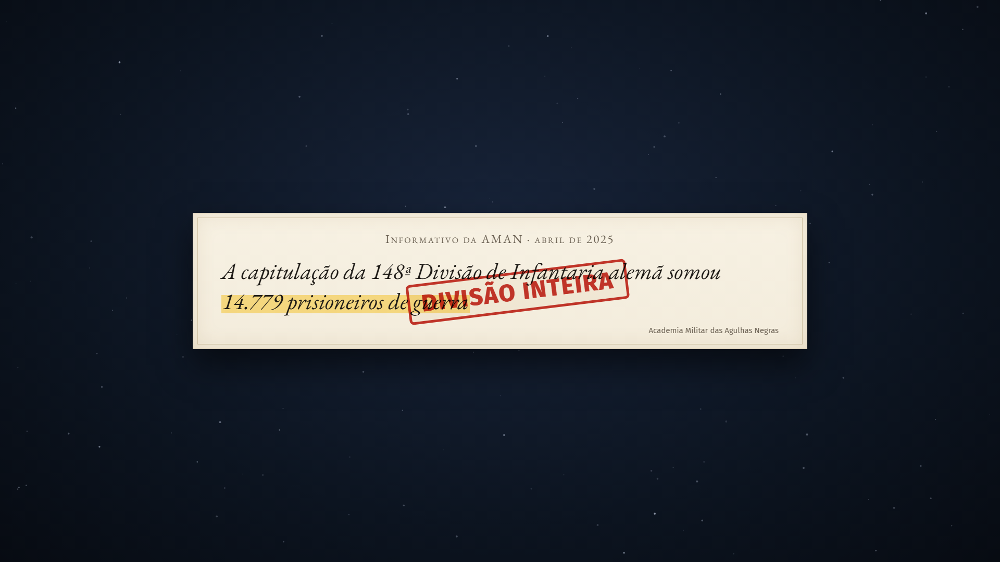
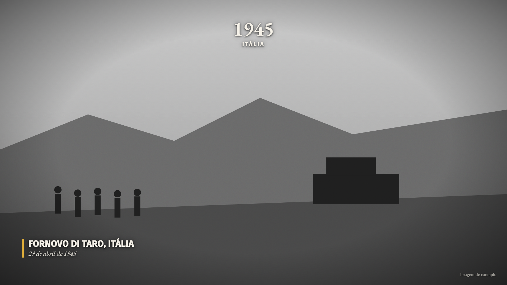
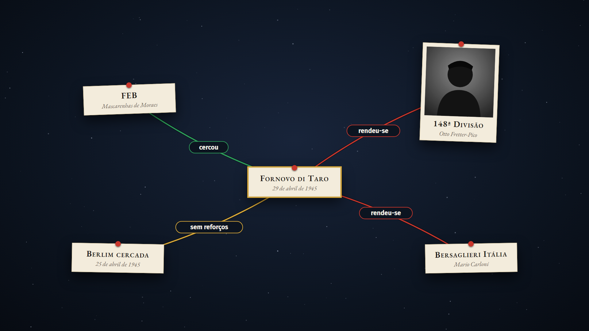
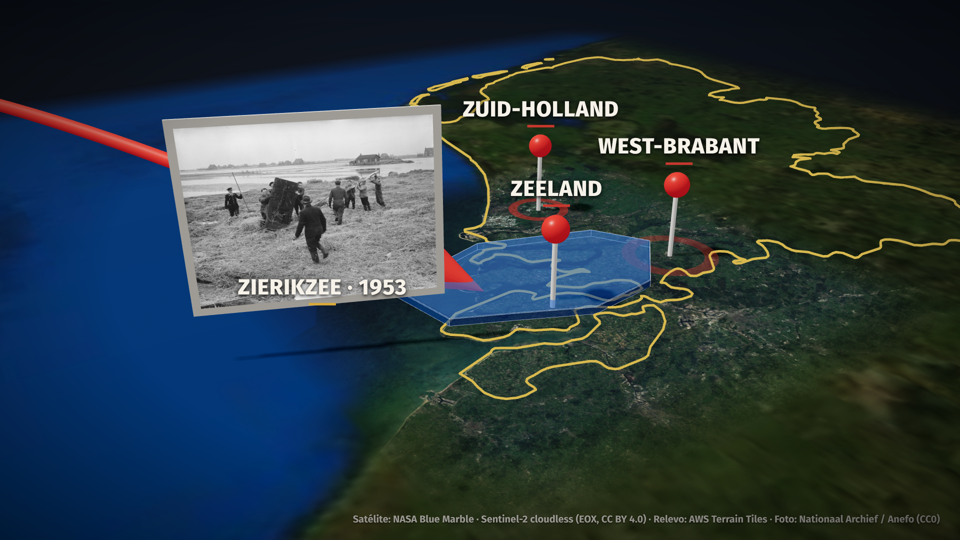

# DocumentaryStyle

**Skill do Claude Code + componentes Remotion para vídeos no estilo documentário de arquivo.**
Um roteiro narrado vira um vídeo 16:9 com material real em tela cheia, mapa de satélite real animado,
cartões de documento, números, linha do tempo e quadro de ligações de fatos.



| | |
|---|---|
|  |  |
|  |  |



## Instalar no Claude Code
```
/plugin marketplace add raphael321/DocumentaryStyle
/plugin install documentary-style@documentary-style
```
Para pegar melhorias depois:
```
/plugin marketplace update documentary-style
```

Depois peça, por exemplo: *"use o DocumentaryStyle para montar o vídeo do roteiro ROTEIRO-FORNOVO.md"*.

## O que vem
| Bloco | Para quê |
|---|---|
| `arquivo` | vídeo/foto real em tela cheia (ou 4:3 com fundo desfocado), Ken Burns, granulação, legenda LOCAL + data, crédito |
| `mapa` | satélite NASA + países/rios Natural Earth; câmera com zoom; países pintados, rotas com ícone, setas, pinos, medalhões de pessoas, cercos, áreas |
| `cena3d` | **3D com motion graphics sobre o mapa real (prioridade em toda animação)**: satélite NASA/Sentinel-2 sobre o relevo real, fronteira que se desenha, áreas que sobem, colunas, pinos, arcos de rota, fotos reais em placas no espaço, modelos .glb, câmera que orbita e mergulha (three.js via `@remotion/three`) |
| `globo` | globo 3D girando e aproximando, com países, pinos e arcos |
| `documento` | cartão de papel com citação, marca-texto `[[...]]` e carimbo vermelho |
| `foto` | foto em moldura de papel com legenda |
| `numero`, `barras` | número de impacto e comparação |
| `linhaTempo` | régua de anos ou selo de ano por cima do vídeo |
| `conexoes` | quadro de ligações: cartões ligados por linhas com rótulo |

O vídeo inteiro é descrito num `Plano` (lista de cenas com blocos) e renderizado pelo `DocVideo`.
Veja `plugins/documentary-style/skills/documentary-style/templates/doc/demo.ts`.

## Requisitos
- Projeto Remotion 4 (React 18/19). Nenhuma dependência extra.
- Node 18+ para os scripts.
- Internet no render (fontes EB Garamond e Fira Sans do Google Fonts).

## Dados de mapa (baixados pelo script, não ficam no repositório)
- Satélite: NASA Earth Observatory, Blue Marble Next Generation (domínio público).
- Países e rios: Natural Earth (domínio público).
- Recorte regional (experimental): Sentinel-2 cloudless 2016, EOX IT Services, CC BY 4.0, com crédito obrigatório.

## Como melhorar
1. Edite os componentes em `plugins/documentary-style/skills/documentary-style/templates/doc/`.
2. Teste num projeto Remotion: `node .../scripts/instalar.mjs <projeto> --forcar` e renderize stills.
3. Suba a versão em `plugin.json` e `marketplace.json`, anote no `CHANGELOG.md`, faça commit e push.
